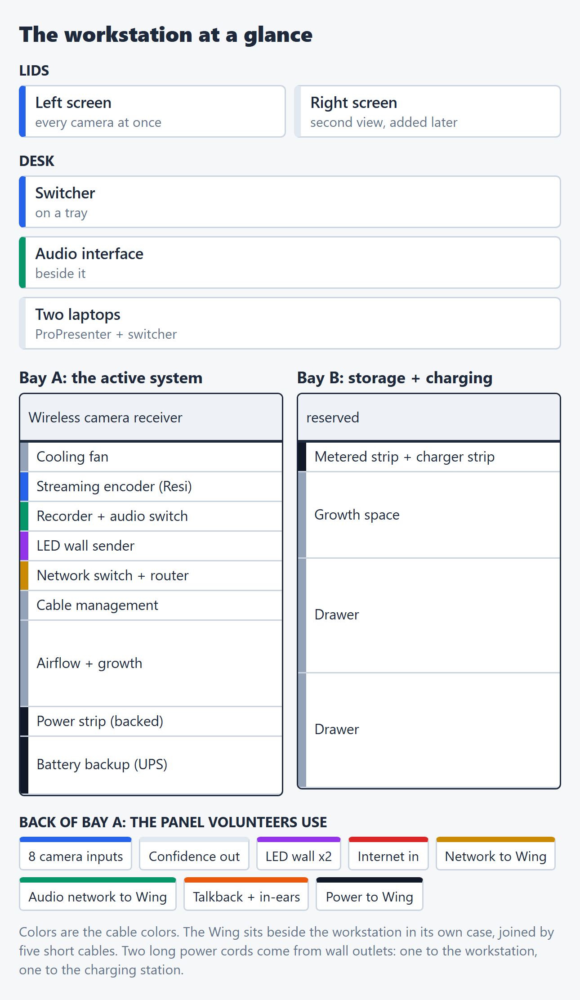
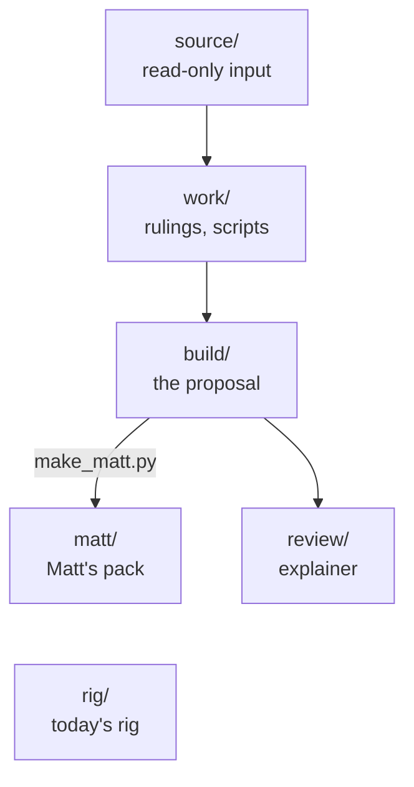

# ELIM AVPRO Production Station

The build docs for the ELIM production workstation: a ProX AVPRO rolling case for video, network and power, the Behringer Wing in a ProX BXWING flip case beside it, and one labeled panel on the back where every field cable plugs in. This repo is the master copy.

> [!IMPORTANT]
> **Nothing is ordered.** The locked decisions are in [DESIGN §5](build/DESIGN.md#5-locked-decisions-do-not-re-debate). Open items remain: [OPEN-ITEMS](build/OPEN-ITEMS.md).
> Target order date: **2026-10-19**, pending Matt's case and freight quote.
> *As of 2026-10-01.*

**Start here**
- **Bianca and Sunny:** [the explainer](review/drafts/ELIM-Workstation-Explainer-WORKING-DRAFT.pdf)
- **Bianca's 1:1:** [the decision sheet](review/drafts/ELIM-Bianca-Decision-Sheet-WORKING-DRAFT.pdf)
- **Matt:** [the pack](matt/MATT-PACK.pdf) · [BOM](matt/BOM.xlsx)
- **Build crew:** [build set](build/README.md) · [build spec](build/BUILD-SPEC.md) · [backlog](build/BACKLOG.md)
- **Sam:** [status](work/STATUS.md) · [open items](build/OPEN-ITEMS.md)

## Key numbers

| | |
|---|---|
| First order | $4,641.84, of which $1,650.00 is the case and freight placeholder ([BOM v8](build/BOM.xlsx)) |
| Wing panel block | +$100.00, only if the Wing case can take a panel. All lines $4,741.84 |
| Battery backup load | ~275–465W of 1000W, estimated ([build spec §4](build/BUILD-SPEC.md#4-power)) |
| Setup | ~40 loose connections become ~15 labeled cables, about 30 minutes saved each way. Estimates, to be measured (OPEN-ITEMS N15) |
| Cameras | Three at every event ([build spec §2](build/BUILD-SPEC.md#2-cameras)); the panel has 8 camera jacks |

Colors are cable colors: blue camera/SDI, white HDMI, green Dante, yellow production network, red internet, purple LED data, orange XLR and AES50, black power.

## Folders

| Folder | What it is | When it changes |
|---|---|---|
| [`rig/`](rig/CURRENT-RIG.md) | The rig as it runs today | Only when the real rig changes |
| [`build/`](build/README.md) | The AVPRO proposal: design, build spec, BOM, open items, diagrams. The master set | When Sam rules |
| [`review/`](review/) | The explainer and decision sheet in `drafts/`, the rulings log in `src/`. ELIM-PLAN is kept for history | When the documents are revised |
| [`matt/`](matt/) | The pack for Matt, generated from `build/` | Regenerated after any build/ change; never hand-edited |
| [`work/`](work/STATUS.md) | Status, rulings, proposals and the scripts | Every session |

`source/` is the read-only input and `archive/` holds superseded docs.

`rig/` and `build/` stand apart: one is today's rig, the other is the proposal.

## How it connects

The signal chains and the power path are drawn in the [build set README](build/README.md#how-it-connects): video in and out, audio and Dante, the production network, and power from the wall.

## How this repo works

- **Every fact has a status:** decided, assumed, open or conditional. A maybe is never written as settled.
- **Locked decisions** ([DESIGN §5](build/DESIGN.md#5-locked-decisions-do-not-re-debate)) change only through a written proposal ([work/PROPOSALS.md](work/PROPOSALS.md)) that Sam accepts.
- **Fact precedence:** for the rig as it runs today, the ELIM Production App wins; for the build, `build/` wins.
- **Regenerate** after a build/ change: `work/make_bom.py`, then `build/diagrams/render.py`, then `work/make_matt.py`. Totals in the BOM are formulas.
- samholub/elim-avpro is a dormant presentation experiment. It isn't a source.
