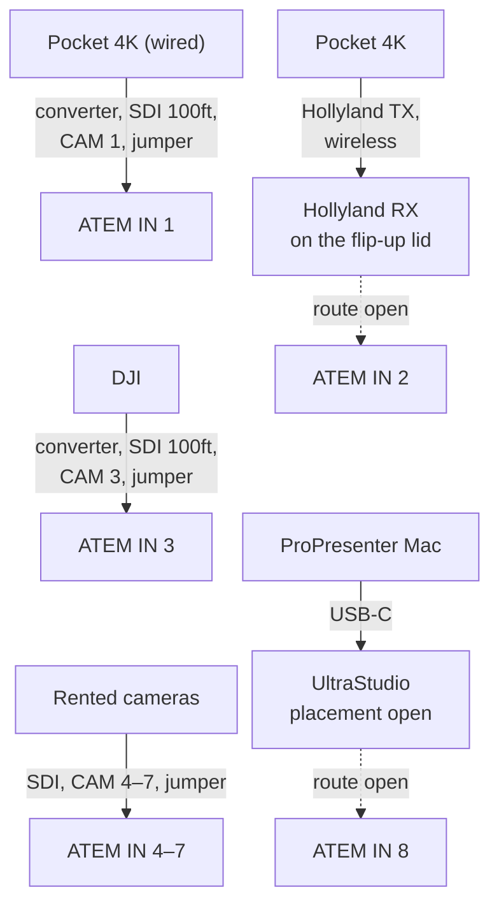
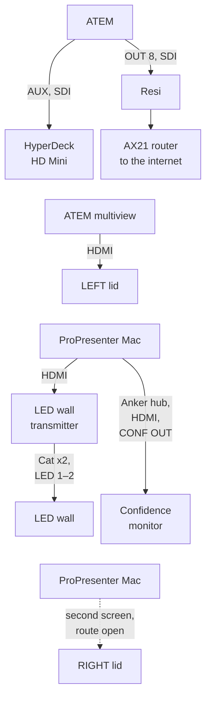
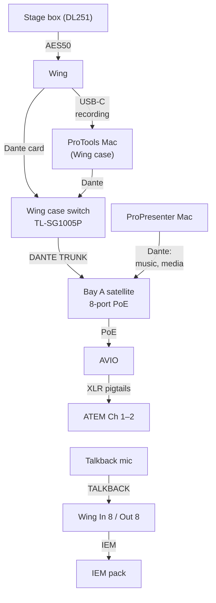
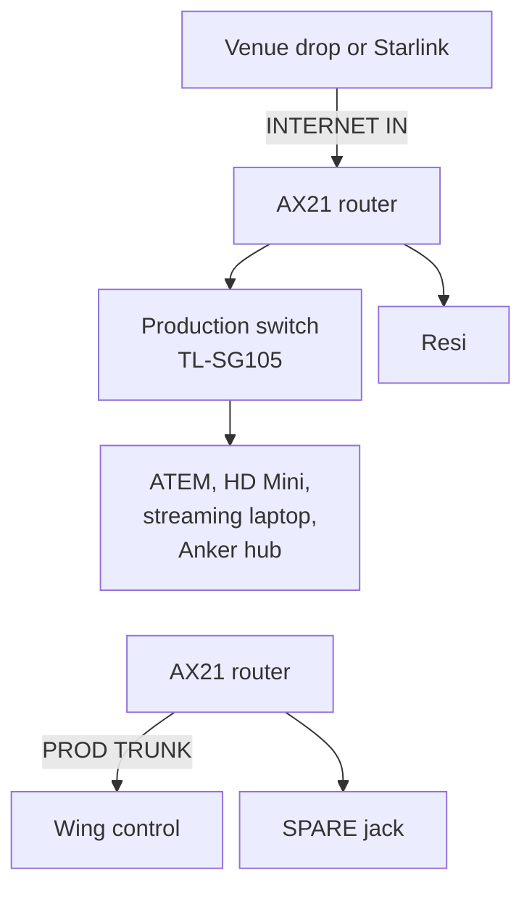
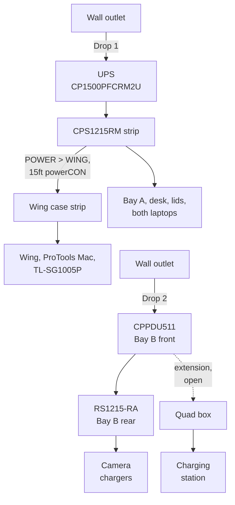

# ELIM AVPRO Production Station: Build Set

> samholub/elim-avpro is a dormant presentation experiment built from this repo at tag v1.1-baseline. This repo is the source.

rig/ is the rig as it runs today. build/ is the AVPRO proposal. rig/ changes only when the real rig changes.

This folder is the master for the ELIM AVPRO workstation and Wing case build. All edits happen here, in the repo. A decision isn't real until it's in `build/`.

**Updated:** 2026-10-01 (diagrams added)

## Status

1. Nothing ordered. Locked decisions are in DESIGN §5; open items remain.
2. BOM v9: **first order $4,641.84** (of which $1,650.00 is the case + freight placeholder, to verify with Matt). Wing panel block **$125.88**, only if the BXWING can take a panel. All lines $4,767.72.
3. Target order date: **2026-10-19**, pending Matt's quote.
4. Waiting on: Matt's case and freight quote; the powerCON and etherCON part check (D7); whether the lid legs come with the case. Sam and Bianca: the case and freight spend ceiling, before the Sunny walkthrough (G8).
5. Rulings from the 2026-10-01 design session are logged in `../review/src/DESIGN-RULINGS.md`. Working drafts of the explainer, Bianca's decision sheet and the review doc are in `../review/drafts/`.
6. Next: order → fabricate → assemble → prove (`BACKLOG.md`).

## What gates the order

| Gate | Owner |
|---|---|
| Case and freight quote (the order gate) | Matt |
| Case and freight spend ceiling (whether it gates isn't stated) | Sam, Bianca |
| One matched powerCON TRUE1 family + the etherCON pair (NE8FDP-B jacks, NE8MX-1 carriers), checked against the datasheets | Matt / vendor, Sam |
| Rack rails and thread | Sam. Gates the screw line only |

Full list with dates: `OPEN-ITEMS.md`.

## Files

| File | What it is | For |
|---|---|---|
| `README.md` | This page | Everyone |
| `DESIGN.md` | Overview, team, approval chain, principles, locked decisions, network, power, process | Sam, Bianca |
| `BUILD-SPEC.md` | Dimensions, cameras, signal map, power, both panel maps, connector stock, rack placement, monitors, cooling, cabling, color code | Sam, Bianca, Matt |
| `BOM.xlsx` | The buy list (v9). Tabs: Buy, Owned, Check, Changes. Totals are formulas | Sam, Matt |
| `OPEN-ITEMS.md` | Every open item with owner, due date and whether it gates the order. Resolved log | Sam |
| `BACKLOG.md` | Order → fabricate → assemble → prove, as checkboxes | Sam, Bianca |
| `ROADMAP.md` | What comes after the build: stage power, Stream Deck, Mac Minis, parked items | Sam |
| `CHANGELOG.md` | Decisions and milestones, most recent first | Sam |
| `OPS-CONFIG.md` | Running config: ATEM, HyperDeck, levels, cameras, IPs, day-of checklist | Sam, crew |
| `diagrams/` | Rack layout and cable map (JSX source + PNG) | Everyone |
| `../review/drafts/` | Working drafts: the explainer (for meetings), Bianca's decision sheet, the review doc. PDFs are the readable copies | Team |
| `../review/ELIM-PLAN.pdf` | The earlier plan. Superseded for meetings by the explainer (2026-09-30); kept for history | Team |
| `../matt/` | The pack for Matt. **Generated from build/ by `work/make_matt.py`; don't hand-edit** | Matt |

## How it connects

Solid arrows are decided. Dashed arrows marked "open" are open. Labels on the arrows name the cable and the panel jack it passes through. A device can appear more than once in a chart so the chart fits a phone screen; repeated boxes are the same device. Tap a chart's name to open it. Full tables: `BUILD-SPEC.md` §3 (signals) and §4 (power).

<b>Video into the switcher</b>

BUILD-SPEC §2 and §3 (Video). IN 2 is always the Hollyland RX and IN 8 is always the UltraStudio; how each one connects is open (OPEN-ITEMS N24).

<b>Video out</b>

BUILD-SPEC §3 (Video).

<b>Audio and Dante</b>

BUILD-SPEC §3 (Audio and Dante).

<b>Production network and internet</b>

BUILD-SPEC §3 (Production network and internet).

<b>Power</b>

BUILD-SPEC §4. Drop 1 and drop 2 are the two 125ft 12/3 SOOW venue drops. The extension to the quad box is open (OPEN-ITEMS N28). The powerCON link feeds the Wing case strip; the Wing, the ProTools Mac and the TL-SG1005P plug into it (decided, 2026-10-01).

## Rules

- **Fact precedence:** for the rig as it runs today, the ELIM Production App wins; for the future build, this project wins; Claude Design wins on nothing factual.
- A locked decision (DESIGN §5) changes only through a proposal Sam accepts.
- Every number in `review/` and `matt/` comes from `BOM.xlsx`. If the BOM changes, regenerate matt/ and update review/.
