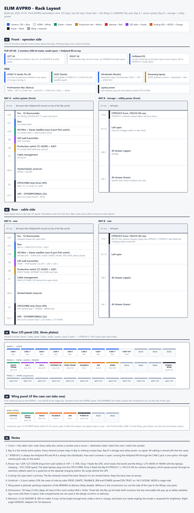

# ELIM AVPRO + Wing Build: Pack for Matt

**Generated from the build set on 2026-10-01 (BOM v8).** Don't edit this file; it's rebuilt from `build/`.

## 1. Scope

ELIM Church runs a portable production rig that deploys once or twice a week at different venues, set up and struck by volunteers under time pressure. This build consolidates the video, network and control gear into a ProX AVPRO rolling workstation (two 12U bays, two 4U tops, a work surface and three lids: the flip-up lid holds both monitors, and the two removable lids pop up as tables). Bay A is the active-system side of the rack; Bay B is the storage and camera-charging side. The Behringer Wing rides in a ProX BXWING hydraulic flip case beside it. Every field cable (cameras, LED wall, confidence monitor, internet) and the five-cable Wing umbilical lands on one labeled, color-coded Neutrik D-series panel on the back of the AVPRO. Almost all the gear inside is already owned. The new spend is the cases, power, cooling, mounts, connectors, cabling and two lid monitors. All cabling is stored with the two cases.

The design is locked. We'd like your quote on the cases and freight, your help pinning a few connector parts, and a sanity check from an outside AV pro.

## 2. Questions for you

1. **Case and freight quote:** AVPRO price, BXWING price, consolidated freight for both (closed AVPRO is 51.5 × 48.2 × 31.6in). BOM placeholders: $500 / $900 / $250  
   *When: 2026-10-19. Gates the order? Yes: the order gate*
2. **One matched powerCON TRUE1 family:** AVPRO chassis outlet, both umbilical cable ends, and the Wing chassis inlet (only if the Wing panel happens). **Plus the etherCON pair:** NE8FDP-B panel jacks with NE8MX-1 carriers (standard etherCON; the NE8MC-1 Sam named is discontinued and the NE8MX-1 is its successor), checked against the Neutrik compatibility table before the BOM calls them firm  
   *When: 2026-10-19. Gates the order? Yes, for the connector lines*
3. **Rack rails and thread:** tapped 10-32, or square-hole for M6 cage nuts? Both are open. Also open: whether the AVPRO comes with rails built in or they're added after purchase. Do you know? If not, we check the rails at delivery  
   *When: on case delivery (assumed by 2026-11-15). Gates the order? Screw line only. If you don't know, we order the screws after delivery*
4. **BXWING inspection: can it take a panel-mount D-series plate?** Likely doable (2026-10-01), not confirmed. Yes → buy the Wing block. No → the connections run out the side of the case + a TRUE1-to-IEC jumper  
   *When: on case delivery (assumed by 2026-11-15). Gates the order? Wing block only*
5. **Side doors:** do the AVPRO side doors open to usable storage, and what are the inside dimensions? The design doesn't use them  
   *When: on case delivery (assumed by 2026-11-15). Gates the order? No*
6. **Camera-cable trial:** Emily runs the SDI cables we already own (100ft) over a real deploy. Checks pull-through, cable and connector reliability, and picture over length. No camera control. **AOC instead of SDI is an open decision:** about $150 for a 50m run on a spool (estimate), not in the BOM. *Open*  
   *When: not set. Gates the order? No*
7. **The "regret ask":** long-lead items, freight consolidation, anything hard to add later  
   *When: 2026-10-19 (with the quote). Gates the order? No*
8. **Lid legs:** do legs come inside the two removable AVPRO lids? If they don't, we add them as a line item  
   *When: 2026-10-19. Gates the order? No*
9. **ATEM retention tray:** open, not costed. Build a foam or plywood tray, or secure the ATEM another way  
   *When: not set. Gates the order? Not stated (not costed)*

## 3. Panel maps

### AVPRO rear I/O panel

Three Neutrik D-series 12-hole plates (3U) on the Bay A rear rails, behind the upper gear block. This is the one face volunteers touch. Field cables land here; short jumpers run to the gear. Nothing plugs into a device directly. *Decided.*

```
PANEL 1  [CAM1][CAM2*][CAM3][CAM4][CAM5][CAM6][CAM7][CAM8*][CONF OUT][ -- ][ -- ][ -- ]
PANEL 2  [DANTE][LED1][LED2][INTERNET IN][PROD][TALKBACK][IEM][SPARE][ -- ][ -- ][ -- ][POWER > WING]
PANEL 3  [ spare / expansion row, 12 holes ]
         * ATEM IN 2 / IN 8 route open (see the signal map)   -- = blanking plate
```

| Jack | Connector | Direction / gender | Inside, goes to | Color |
|---|---|---|---|---|
| CAM 1, 3–7 | BNC 75Ω feedthrough | in | SDI jumper → ATEM IN n | blue |
| CAM 2, CAM 8 | BNC 75Ω feedthrough | in | SDI jumper → ATEM IN 2 / IN 8. Whether the Hollyland RX or the UltraStudio route through them is open | blue |
| CONF OUT | HDMI feedthrough | out | Anker hub HDMI | white |
| DANTE TRUNK | etherCON | both | satellite switch | green |
| LED 1, LED 2 | etherCON | out | LED transmitter ports 1, 2 | purple |
| INTERNET IN | etherCON | in | AX21 WAN | red |
| PROD TRUNK | etherCON | both | AX21 LAN 3 | yellow |
| TALKBACK | XLR **female** | in (a mic plugs in) | trunk to the Wing | orange |
| IEM | XLR **male** | out (feeds a pack) | from the Wing | orange |
| SPARE | etherCON | both | AX21 LAN 4 (pre-wired) | yellow |
| POWER > WING | powerCON TRUE1 **outlet** | out | fed from the CPS1215RM (UPS side) | black |

- Order and labels follow layout v15 (POWER > WING last; TRUNK names). *Decided.*
- The POWER jack is an **outlet**: power leaves the AVPRO here. Shore power enters through the UPS line cord, not this jack.
- 18 empty holes get blanking plates. Panel 3 is the growth row (camera returns, more trunks).

### Wing panel (conditional)

**Planned, pending physical inspection of the BXWING.** Nobody has confirmed the case can take a panel, but it's likely doable. Sam inspects on case delivery. The parts are a separate BOM block ($100.00) and are not in the first order. *Conditional.*

```
WING PANEL  [CONTROL][DANTE TRUNK][AES50][TALKBACK][IEM][POWER IN][ -- ][ -- ]
```

| Jack | Connector | Gender / direction | To |
|---|---|---|---|
| CONTROL | etherCON | both | Wing control port → PROD trunk → AX21 |
| DANTE TRUNK | etherCON | both | Wing case Dante switch uplink |
| AES50 | etherCON | both | stage box (stage side, not on the umbilical) |
| TALKBACK | XLR **male** | out to the Wing In 8 | mirrors the AVPRO's female |
| IEM | XLR **female** | in from the Wing Out 8 | mirrors the AVPRO's male |
| POWER IN | powerCON TRUE1 **inlet** | in | pigtail to the Wing's IEC inlet |

- **Inside the case:** the Wing case Dante switch (owned TL-SG1005P, 5-port, 3 ports used; 4 while the stream-mix laptop stays in use) and the ProTools Mac. Nothing in the design powers either one yet: the powerCON inlet feeds only the Wing. Open. The ProTools Mac has two links: USB-C to the Wing for recording and a Cat patch to the Dante switch.
- Genders mirror the AVPRO panel: talkback female ↔ male, IEM male ↔ female, POWER outlet ↔ inlet.
- **Fallback if the case can't take a panel:** the connections run out the side of the case to the Wing's own jacks. etherCON ends plug into ordinary RJ45 jacks (Wing control, the Dante switch). The XLRs plug into Wing In 8 / Out 8. Power: the umbilical's female TRUE1 end reaches the Wing's IEC inlet through a short TRUE1-to-IEC C13 jumper (BOM fallback line, qty 0 until needed). The fallback changes the route, not the connectors.

## 4. Port and signal map

### Signal map

#### Video

| From | Cable | To | Color |
|---|---|---|---|
| Wired Pocket 4K (converter) | SDI field, 100ft (owned) | Panel CAM 1 → jumper → ATEM IN 1 | blue |
| Hollyland RX (on the flip-up lid) | SDI, route open | ATEM IN 2 | blue |
| DJI (converter) | SDI field, 100ft (owned) | Panel CAM 3 → jumper → ATEM IN 3 | blue |
| Rented cameras | SDI field | Panel CAM 4–7 → ATEM IN 4–7 | blue |
| ProPresenter Mac → UltraStudio Monitor (placement open) | USB-C, then SDI, route open | ATEM IN 8 | blue |
| ATEM AUX | SDI | HyperDeck HD Mini (records the clean feed) | blue |
| ATEM OUT 8 | SDI | Resi encoder | blue |
| ATEM multiview | HDMI | LEFT lid monitor | white |
| ProPresenter Mac, native HDMI | HDMI | LED wall transmitter (Bay A U9) | white |
| LED transmitter, 2 × ethernet | Cat, short | Panel LED 1, LED 2 → LED wall | purple |
| ProPresenter Mac → Anker hub | HDMI | Panel CONF OUT → confidence monitor (stage) | white |
| ProPresenter Mac, second screen | route open | RIGHT lid monitor | — |

**ATEM IN 2 and IN 8.** IN 2 is always the Hollyland RX and IN 8 is always the UltraStudio. *Decided.* How each one connects is open. With the Hollyland RX on the flip-up lid, its SDI still has to reach IN 2; running it through the CAM 2 jack is one option. All eight camera jacks stay on the panel, so every switcher input is visible.

#### Audio and Dante

| From | Cable | To | Color |
|---|---|---|---|
| Stage box (Midas DL251) | AES50 | Wing (via the Wing panel AES50 jack if the panel happens) | orange boot |
| Wing Dante card | Cat | Wing case Dante switch (owned TL-SG1005P, 5-port) | green |
| Wing case Dante switch | DANTE trunk | AVPRO panel DANTE TRUNK → Bay A Dante satellite (new 8-port PoE switch) | green |
| Satellite switch | Cat, PoE | AVIO (desk). The AVIO is PoE-powered (confirmed) | green |
| AVIO | XLR pigtails | ATEM audio Ch 1–2 | orange |
| Bianca's Mac, USB-C ethernet adapter | Cat | satellite switch (Dante). It plays music and media over Dante | green |
| Tyler's ProTools Mac (in the Wing case) | Cat | Wing case Dante switch. It's a Dante endpoint as well as the USB-C recorder, and it runs the live and stream mixes (decided). The stream-mix laptop is still in use today; its retirement is happening separately from the AVPRO plan (open). | green |
| Bianca's talkback mic | XLR | AVPRO panel TALKBACK → trunk → Wing XLR In 8 | orange |
| Wing XLR Out 8 | XLR trunk | AVPRO panel IEM → Bianca's IEM pack | orange |
| Wing | USB-C | Tyler's Mac (in the Wing case) for recording | — |

- Wing In 8 = Bianca's talkback, Out 8 = her IEM, per the current rig's port map. *Decided, 2026-09-29.*

#### Production network and internet

| From | Cable | To | Color |
|---|---|---|---|
| Venue drop or Starlink | Cat field | Panel INTERNET IN → AX21 WAN | red |
| AX21 LAN 1 | Cat | Production switch (TL-SG105) | yellow |
| AX21 LAN 2 | Cat | Resi | yellow |
| AX21 LAN 3 | PROD trunk | Panel PROD TRUNK → Wing CONTROL | yellow |
| AX21 LAN 4 | Cat | Panel SPARE (etherCON, pre-wired) | yellow |
| Production switch | Cat | ATEM, HD Mini (auto-trigger), streaming laptop, Bianca's Anker hub | yellow |

- **Port count:** that fills every wired production port (AX21 4 of 4, switch 5 of 5). A future device (Stream Deck host, Mac Mini) needs a bigger switch (a bigger production switch is on the roadmap).

## 5. Power

### Power

The rig runs on whatever a venue gives. It draws well under one 15A circuit, so one works. **Two are preferred:** the UPS on one, the charging side on the other. Never tie circuits together. *Decided.*

#### Venue power drops

Power reaches the rig area on **two 125ft 12/3 SOOW drops** from wall outlets. *Decided.*

| Drop | Wall end | Rig end | Feeds |
|---|---|---|---|
| Drop 1 | 5-15P plug | one 5-15R connector body | the AVPRO UPS line cord (and the Wing, through the AVPRO) |
| Drop 2 | 5-15P plug | one 5-15R connector body | the Bay B CPPDU511 cord. The CPPDU511 passes power through an extension to a quad box at the separate charging station |

- **Both drops are built the same:** 125ft 12/3 SOOW, a Hubbell HBL5266C plug, a Hubbell HBL5269C connector body. Either one can stand in for the other. The Hubbell part numbers are assumed, not a ruling; an equal 15A industrial plug and connector body can be substituted.
- **Drop 1 needs one receptacle.** The UPS is the only thing plugged into it; everything else hangs off the UPS.
- **Quad box at the charging station** (4 outlets, 2ft 12/3 tail with a 5-15P). The charging station is a separate table, fed from the Bay B CPPDU511 by an extension that ends in the quad box. *Decided, 2026-09-29.* The extension's details are open and not costed. The BarnDoor part is assumed, not a ruling.
- Voltage drop: 12AWG over 125ft at these loads (2–3A) is about 1%. Fine.
- Plug each drop into a different wall circuit when the venue has two. If not, both on one is fine; the total is still well under 15A.

#### UPS side (battery-backed)

drop 1 → **CyberPower CP1500PFCRM2U** (2U, pure sine, 1000W) → **CyberPower CPS1215RM** (basic 1U strip, no surge, no meter) → Bay A gear, desk gear, lids, and the **POWER > WING** powerCON outlet → short powerCON umbilical → Wing.

- One UPS backs both cases. The BXWING can't carry its own UPS, so this is the only way to back the Wing. For standalone use the Wing goes on a wall outlet. *Decided.*
- **No surge behind the UPS.** Stacked surge behind a UPS isn't good practice, and Bay B's metered CPPDU511 already gives us a meter. That's why the ProX X-PC10ASTRO was passed on. *Decided.*
- **Laptops:** the two desk laptops plug straight into the **CPS1215RM** (battery-backed), so they keep running if venue power drops. There's no separate laptop strip. *Decided (2026-09-30).*
- The UPS LCD meters the combined booth + Wing load.
- **Outlet count.** The CPS1215RM has 12 outlets. The UPS side has 14 loads: ATEM, HD Mini, Resi brick, LED transmitter, the 8-port PoE switch's brick, TL-SG105 brick, AX21 brick, fan, two monitor bricks, the Hollyland RX brick, the POWER > WING feed cord and the two laptop chargers (they replace the one laptop strip). *Decided (2026-10-01).* Six are wall-warts that block a neighbour. The UPS's own outlets (8 on the CP1500PFCRM2U) take the overflow; if bricks still crowd the strip, 1ft outlet-saver pigtails fix it (not in the BOM).

#### Charging side (not backed)

drop 2 → **Clear Power CPPDU511** (Bay B front, metered, drawer down-lights) → **Tripp Lite RS1215-RA** (Bay B rear, camera chargers), plugged into a CPPDU511 rear outlet so both read on one meter. *Decided.* The CPPDU511 also feeds the extension to the quad box at the charging station. *Decided; the extension is open.* Dropping the RS1215-RA is an open proposal only; it stays in the BOM.

- Label both Bay B strips **"chargers + lights only"**. No high-draw loads. Keep the total under 15A.

#### Estimated draw, UPS side

| Device | Est. |
|---|---|
| ATEM TV Studio Pro 4K | ~35W |
| HyperDeck HD Mini | ~10W |
| Resi | ~20W |
| LED wall transmitter | ~30W |
| Production switch + AX21 | ~20W |
| Dante satellite switch | ~5W |
| UltraStudio + Hollyland RX | ~15W |
| 2 × lid monitors | ~50W |
| 2 × laptops (0 when charged) | ~0–180W |
| Wing (over the umbilical) | ~90–100W |
| **Total** | **~275–465W** |

- That's 28–47% of the UPS's 1000W; the high end is both laptops charging. **Spare: ~535–725W (about 4.5–6A at 120V).** Enough for Starlink (~50–75W) and other ad-hoc gear on backup.
- Estimates only. The UPS LCD shows the real number; log it at the first bench test.
- Field devices (confidence monitor, LED wall, cameras and converters) are powered where they sit.
- Utility side: camera chargers and drawer lights. Well under 15A.

#### Umbilical (AVPRO ↔ Wing)

Five short cables, all color-coded and labeled. The cases always sit side by side. *Decided.*

| Cable | Length | Ends | Owned? |
|---|---|---|---|
| PROD trunk | 15ft | etherCON both ends | buy (BOM trunk cable + carriers) |
| DANTE trunk | 15ft | etherCON both ends | buy (BOM trunk cable + carriers) |
| TALKBACK | 15ft | XLR | owned (Sam) |
| IEM | 15ft | XLR | owned (Sam) |
| POWER | 15ft, 14/3 SJOOW | powerCON TRUE1 male (AVPRO end), female (Wing end) | buy |

- The 15ft length leaves room to angle the cases.
- **Why 14/3 for the power link:** Neutrik lists the TRUE1 cable connector (NAC3FX-W) for 6–12mm cable. 12/3 SOOW (the drop cable) is 15.1mm and won't fit; 14/3 SJOOW is 9.4mm, rated 18A. The Wing draws about 1A.
- **Flexibility:** if a venue ever needs the cases apart, add longer trunks and a longer powerCON link then. Nothing on either panel changes.
- powerCON family: one matched TRUE1 family for the outlet, both cable ends, and the Wing inlet. You or the vendor confirm it before we order.

## 6. Fill hardware

Quantities and prices are in the attached `BOM.xlsx` (tabs: Buy, Owned, Check, Changes). The last column below is the price status (est / firm / quoted / placeholder / decided), not the price. Cases and freight are left off this list; they're question 1.

- **First order:** $4,641.84, of which $1,650.00 is the case and freight placeholder (AVPRO $500, BXWING $900, freight $250). Without cases: $2,991.84.
- **Wing panel block:** $100.00, bought only if the BXWING can take a panel.

### First order

| Group | Item | Model / SKU | Qty | Price status |
|---|---|---|---|---|
| AVPRO panel | 1U 12-hole D-series plate | My Cable Mart D-series | 3 | est |
| AVPRO panel | BNC 75 ohm feedthrough (camera SDI) | Neutrik NBB75DFI | 8 | est |
| AVPRO panel | HDMI feedthrough | Neutrik NAHDMI-W-B | 1 | est |
| AVPRO panel | etherCON feedthrough | Neutrik NE8FDP-B | 6 | est |
| AVPRO panel | XLR female chassis | Neutrik NC3FD-L-B-1 | 1 | est |
| AVPRO panel | XLR male chassis | Neutrik NC3MD-L-B-1 | 1 | est |
| AVPRO panel | powerCON TRUE1 chassis outlet | Neutrik NAC3FPX (family to confirm) | 1 | est |
| AVPRO panel | Feed cord for the POWER > WING outlet | 12/3 cord with 5-15P, wired to the outlet | 1 | est |
| AVPRO panel | D-hole blanking plate | Neutrik DBA-BL | 18 | est |
| Spares | BNC feedthrough, spare | Neutrik NBB75DFI | 2 | est |
| Spares | etherCON feedthrough, spare | Neutrik NE8FDP-B | 2 | est |
| Spares | XLR female chassis, spare | Neutrik NC3FD-L-B-1 | 1 | est |
| Spares | XLR male chassis, spare | Neutrik NC3MD-L-B-1 | 1 | est |
| Cable ends | etherCON cable carrier (standard etherCON, over an RJ45 plug) | Neutrik NE8MX-1 (to confirm) | 11 | est |
| Cable ends | RJ45 plugs, shielded (pack), for the carrier ends | Shielded Cat6A RJ45 plugs, 10-pk | 1 | est |
| Cable ends | powerCON TRUE1 cable connector, male | Neutrik NAC3MX-W (to confirm) | 2 | est |
| Cable ends | powerCON TRUE1 cable connector, female | Neutrik NAC3FX-W (to confirm) | 2 | est |
| Power | UPS, 2U pure sine (backs booth + Wing) | CyberPower CP1500PFCRM2U | 1 | est |
| Power | Rack PDU from the UPS (basic, no surge) | CyberPower CPS1215RM | 1 | firm |
| Power | Bay B front PDU, metered, drawer lights | Clear Power CPPDU511 | 1 | firm |
| Power | Bay B rear strip, camera chargers | Tripp Lite RS1215-RA | 1 | quoted 2026-08-20 |
| Cooling | 1U thermostatic exhaust fan | AC Infinity CLOUDPLATE T1 | 1 | est |
| Cooling | 1U perforated blank panel | Steel perforated (Amazon) | 3 | est |
| Mounting | 1U vented cantilever shelf, 10in deep | AC Infinity 1U vented (B01C9KYUG8) | 3 | est |
| Network | Bay A Dante satellite switch, 8-port PoE | PoE model open | 1 | placeholder: PoE model not priced |
| Storage | 4U rack drawer | StarTech 4UDRAWER | 2 | est |
| Cable mgmt | 1U cable lacing bar | StarTech 12S-CABLE-LACING-BAR | 1 | est |
| Cable mgmt | Hook-and-loop straps | ONE-WRAP + WrapStrap | 1 | est |
| Hardware | Rack screws + cage nuts | M6 or 10-32 (open; check the rails) | 1 | est |
| Cabling | SDI BNC jumpers, panel to ATEM | Belden 1855A / premade BNC-BNC | 8 | est |
| Cabling | Cat6A patch, color-coded (lot) | Monoprice SlimRun Cat6A 10-pk | 1 | est |
| Cabling | Trunk cable, shielded Cat6A, 15ft | Shielded Cat6A patch, 15ft | 2 | est |
| Cabling | HDMI 2.0 jumper, short | HDMI 2.0, 6-10ft | 3 | est |
| Cabling | Short power cord, 5-15P to IEC C13 | 2-3ft | 6 | est |
| Cabling | Umbilical power cable (AVPRO > Wing), 14/3 SJOOW | 14/3 SJOOW, cut to length (ft) | 15 | est |
| Venue power | Power drop cable, 12/3 SOOW (2 x 125ft) | 12/3 SOOW, cut to length (ft) | 250 | est |
| Venue power | Edison plug, 5-15P (wall end) | Hubbell HBL5266C | 2 | est |
| Venue power | Edison connector body, 5-15R (rig end) | Hubbell HBL5269C | 2 | est |
| Venue power | Quad box, 4 outlets, 2ft 12/3 tail with 5-15P | BarnDoor QB-M-2FT metal quad box | 1 | decided |
| Monitors | Lid monitor, 24in matte IPS | LG UltraGear 24GS60F-B | 2 | est |
| Monitors | Right-angle HDMI + DC adapters (lot) | 90-deg HDMI + DC barrel | 1 | est |

### Wing panel block (conditional)

| Group | Item | Model / SKU | Qty | Price status |
|---|---|---|---|---|
| Wing panel | Small D-series plate (8 holes) | D-series plate | 1 | est |
| Wing panel | etherCON feedthrough | Neutrik NE8FDP-B | 3 | est |
| Wing panel | XLR male chassis | Neutrik NC3MD-L-B-1 | 1 | est |
| Wing panel | XLR female chassis | Neutrik NC3FD-L-B-1 | 1 | est |
| Wing panel | powerCON TRUE1 chassis inlet | Neutrik NAC3MPX (family to confirm) | 1 | est |
| Wing panel | Inlet-to-Wing power pigtail | IEC C13 cord, cut and wired to the inlet | 1 | est |
| Wing panel | D-hole blanking plate | Neutrik DBA-BL | 2 | est |
| Wing panel | FALLBACK ONLY: powerCON TRUE1 to IEC C13 jumper | TRUE1 male to C13, short | 0 | est |

<div class="pb"></div>

## 7. Layout


