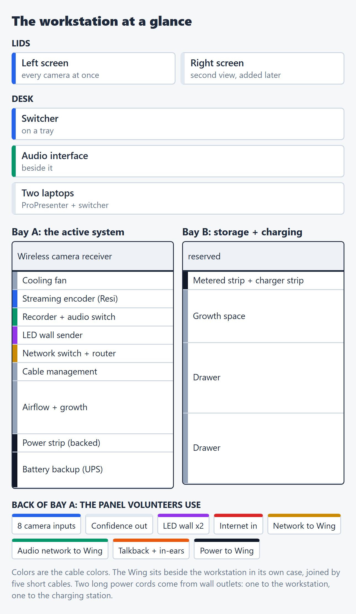

# ELIM Production Workstation: the plan

*Sam Holub, September 2026. Nothing is ordered yet. Numbers are from the parts list (BOM v6, 2026-09-28).*

**The problem.** Every week we rebuild the video and control system from loose parts: about 40 separate connections, a lot of them guessed at, then the same in reverse at teardown. It's slow, it wears on the gear, and it depends on the one or two people who remember how it goes together.

**What we'd build.**

- A rolling workstation case that holds the switcher, recorder, streaming, network and power, with two screens in the lids.
- The Wing in its own flip case beside it, joined by five cables.
- One labeled, color-coded panel on the back where every cable plugs in.

**One-time cost: about $4,900**

- **Includes:** both cases and freight ($1,650; Matt's estimates, to verify), battery backup, power strips and two long power cords, cooling, the connector panel, mounts, drawers, cabling and two screens.
- **Not included:** gear we already own; field camera cable (after a trial); stage power (a later project).
- **Plus $100** for a Wing case connector plate, only if the case can take one.

**Already owned:** the switcher, recorder, streaming encoder, video converters, LED wall sender, Dante audio gear, the router and two of the three network switches, cameras, laptops and the Wing.

**Time saved (estimates; I'll time setup before and after):**

- ~40 loose connections become ~15 labeled cables: about 30 minutes faster to set up and 30 to tear down, roughly an hour a week.
- ~14 devices to handle become ~5; 10+ loose items become 2; one panel instead of four stations.

**The ask.** Bianca: go/no-go on ordering once Matt's quote is in. Sunny: final sign-off. Target: order October 1.

| Still open | Blocks the order? |
|---|---|
| Matt's case and freight price | Yes |
| Connector part numbers (with Matt) | Yes, those parts |
| Where the charging station sits | No |
| Wing case connector plate | No, checked on delivery |
| Screen fit, rack screws, LED wall count | No |

## The layout

- **Left screen** shows every camera at once, straight from the switcher. The right screen comes later.
- **Bay A** holds everything that's switched on. **Bay B** is storage and camera charging.
- **The panel on the back** is the only thing volunteers plug into.
- **Colors are cable colors:** blue cameras, green audio network, yellow control network, red internet, purple LED wall, orange talkback and in-ears, black power.
- A full-size version for phones is attached as **ELIM-layout.png**.

*Everything after this page is detail. Skip what you don't need.*

## How it works

Every cable falls into one of three groups:

- **Local:** inside the workstation and on the desk. Wired once and left alone.
- **Field:** the runs out into the room (cameras, LED wall, confidence monitor, internet). Each is labeled and color-coded and plugs into the back panel. Camera cables are made 125ft long so they reach at any venue.
- **Trunk:** the five cables between the workstation and the Wing: the control network, the audio network, Bianca's talkback, her in-ears, and power.

So setup is the field cables plus five trunk cables, all landing on one panel.

## Inside the workstation

- **Bay A (the active system):** a cooling fan, the streaming encoder, the recorder, the LED wall sender, the network switch and router, and at the bottom the battery backup and its power strip. The connector panel is on the back.
- **Bay B (storage and charging):** two drawers, room to grow, and power strips for camera-battery chargers and the drawer lights. Heavier things go here to balance the case.
- **The desk:** the switcher on a tray, the audio interface next to it, and two laptops: Bianca's Mac running ProPresenter and the switcher laptop running the switcher, recorder and stream software.
- **The screens:** two 24in matte screens in the lids. They're fine under a tent or canopy; in direct sun you'll need to angle them. The left one always shows every camera. The right one is a second view we add later.
- **The panel:** 8 camera inputs (we run three today), a confidence-monitor output, and the network, audio and power connections. Nothing plugs into a device directly, so field wear never reaches the gear.

## Networks

Two separate networks, plus internet coming in through the router:

- **Audio (Dante):** all the digital audio between the Wing, the audio interface and ProPresenter. It's isolated, with no path to the internet.
- **Control:** the switcher, recorder, stream encoder, laptops and the Wing's control.
- **Internet:** Starlink or the venue's connection comes in through the router. It's what the stream goes out on, not a third network.

Keeping audio and control apart means neither can step on the other, and a busy internet connection can't reach the show.

## Power

- **Two long power cords** (125ft) run from wall outlets to the rig: one feeds the workstation and the Wing, the other feeds the charging station.
- **Battery backup:** one unit backs up the workstation and the Wing, so a power blip doesn't drop the stream or the sound. Our gear uses about 275–285W of its 1000W, which leaves room for Starlink and other extras.
- **Regular power:** camera chargers, the drawer lights and the laptop strip run off the second cord, not the backup. The laptops have their own batteries.
- **Venue power:** the whole rig runs on one normal 15A circuit. Two are nicer, one per cord.

## Cameras

- **Three at every event:** two Pocket 4K cameras (one can go wireless) and the DJI. More only when we rent them.
- **How they connect:** a small converter on each wired camera sends the picture down a rugged, locking video cable to the panel. At our resolution that's ordinary, cheap cable with distance to spare.
- **On record:** a converter box near the stage instead of one per camera. It's cleaner if the cameras stay close to the stage, but it doesn't reach as far.
- **Before we buy the long camera cables,** Emily tries one over a real service to check the cable, the connectors and the picture.

## Cost by group

| Group | Cost |
|---|---|
| Cases + freight (Matt's estimates, to verify) | $1,650.00 |
| Power: battery backup and strips | $709.96 |
| Connector panel, spares and cable ends | $626.96 |
| Venue power: two 125ft cords + an outlet box | $561.38 |
| Cabling: jumpers, trunks, short Wing power link | $276.10 |
| Storage, shelves and a network switch | $431.99 |
| Screens (2) | $320.00 |
| Cooling | $186.00 |
| Cable management and rack hardware | $90.00 |
| **First order** | **$4,852.39** |
| Wing connector plate (only if the case takes one) | $100.00 |
| **Everything** | **$4,952.39** |

Page 1 rounds the first order up to about $4,900. The case and freight line is Matt's estimate until he quotes.

## Risks and what we haven't covered

- **Rain.** We often set up outside with no cover. An open-back rack with power in sudden rain is our one fast path to a big loss. The plan: a fitted rain cover or poly sheet and clamps in the case, and a two-minute cover-and-shut-down routine.
- **Single points of failure.** The battery backup, the switcher, the router and the power cords can each take down the video, the stream or the sound if they fail. Our fallback is the old kit, kept ready to deploy through the first season. A written "if this dies, do that" sheet is on the roadmap.
- **Heat.** The open back does most of the cooling. At a venue, don't push the case against a wall.
- **Things still unknown:**
    - whether the Wing case can take a connector plate (checked on delivery; if not, the cables plug straight into the Wing)
    - whether the screens fit the lids exactly (checked on delivery)
    - how the long camera cables hold up (Emily's trial)
- **Room to grow is tight on the control network.** Every wired port is used. Adding a Stream Deck or Mac Minis later means a bigger switch.

## Rollout and cutover

1. **Low-risk first.** Move the gear we already own into the cases, keep the laptops we use now, and get the panel working. Nothing exotic.
2. **Build in focused sessions:** mount and wire; then the panel and cables as their own session (the fiddly part); then the camera cables.
3. **Prove it before relying on it:** test every connection on the bench, run it warm for a while, then do a dry run at the easiest venue with the old kit as backup.
4. **Cut over,** and keep the old kit ready through the first season.

## Roadmap in brief

- **Stage power:** get the instruments off extension cords with a set of drop boxes and two long feeds. Specced with Matt, roughly $1,550–1,700 before freight. Separate from this order.
- **Stream Deck:** big one-touch buttons for record, stream and scene changes.
- **Mac Minis** to replace the laptops, and a feed for the right screen.
- **Later:** a quick "all green" status check, remote help for volunteers, and cases for each instrument.

## What I'd like you to check

1. **Bianca:** does the desk layout work for ProPresenter? Is the right screen needed on day one, or is later fine?
2. **Everyone:** is there anything in how you work today that this would trip on? Now's the time, while it's easy to change.
3. **Sunny:** is about $4,900, with the case price still pending Matt, OK to move to a quote and an order?
4. **Any venue** where the open back, 125ft camera cables, or a single power circuit won't work?
5. **Anything missing** from the "still open" list on page 1?
